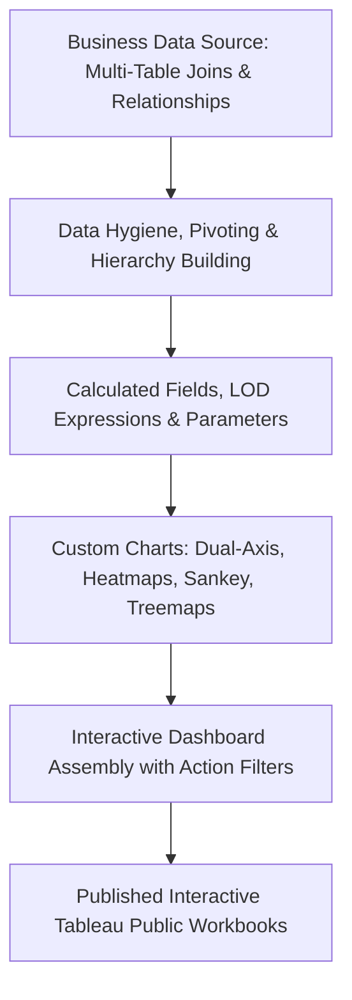

<div align="center">

  <!-- NATIVE ANIMATED CYBER BANNER -->
  

  <br/>

  <!-- ANIMATED TYPING SVG -->
  

  <br/>

  <!-- TECH BADGES -->
  <p align="center">
    
    
    
    
    
  </p>

</div>

---

### 🌟 System Overview

**Tableau Assignment Solutions & Portfolio** is a curated collection of executive business intelligence dashboards developed for complex analytical challenges. It demonstrates advanced mastery of Level of Detail (LOD) expressions, dynamic parameter actions, custom dual-axis visualizations, and responsive dashboard storytelling.

---

### 🔬 Operational Architecture & Data Pipeline Flow



---

### 🚀 Key Capabilities & Features

- **📊 Advanced Level of Detail (LOD):** Implements `FIXED`, `INCLUDE`, and `EXCLUDE` calculations for multi-tier comparisons.
- **🎛️ Dynamic Parameter Slicers:** Enables end-users to dynamically toggle measures (Revenue, Profit, Margin) across dimensions.
- **🎨 Polished Executive Aesthetics:** Employs high-contrast data colorways, clean whitespace, and guided visual storytelling.
- **🌐 Direct Tableau Public Links:** Includes live cloud links for instant interactive exploration without software installation.

---

### ⚡ Quickstart & Execution

```bash
# 1. Clone repository
git clone https://github.com/Akshay-Notfound/tableau-assignments-portfolio.git
cd tableau-assignments-portfolio

# 2. Explore .twbx files in Tableau Reader or Tableau Desktop
```

---

### 👤 Author & Architecture

**Akshay Shivaji Rathod**  
*Data & AI Engineer*  
* 🌐 **Portfolio:** [akshay-notfound.vercel.app](https://akshay-notfound.vercel.app)  
* 💼 **LinkedIn:** [linkedin.com/in/akshay-rathod-aaab52206](https://www.linkedin.com/in/akshay-rathod-aaab52206/)  
* 🐙 **GitHub:** [@Akshay-Notfound](https://github.com/Akshay-Notfound)  

---

<div align="center">
  <sub>Licensed under the MIT License. Designed for scalability, intelligence, and performance.</sub>
</div>
